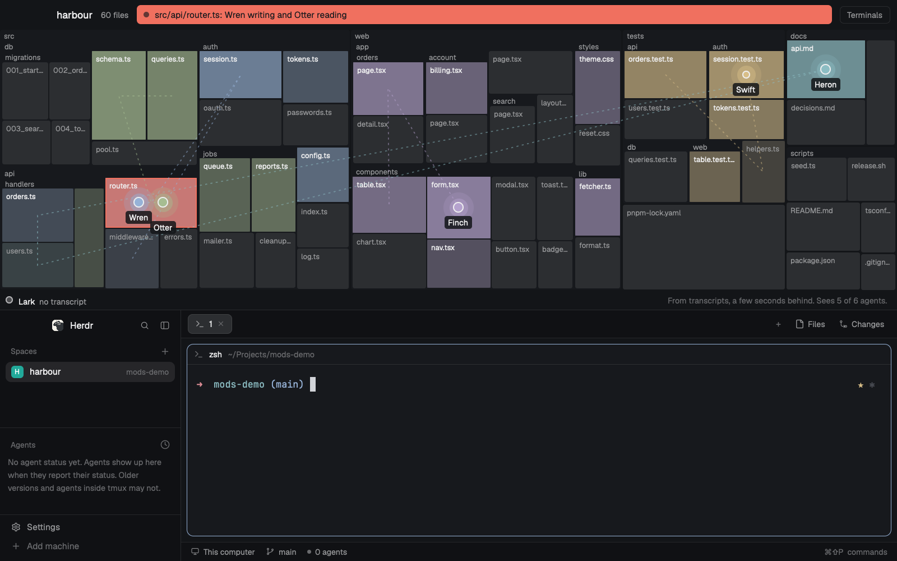

# Territory

A live map of your repo for Herdr: each coding agent is a dot on the file it's in, and a warning shows when two agents are on the same file.

A layout for the [Herdr](https://github.com/ogulcancelik/herdr) desktop app. Built for macOS. Its checks pass on Windows, and it hasn't yet been run in a real window.

It reads tool calls from Claude Code transcripts, so it runs a few seconds behind and only sees agents whose transcripts it can read. It runs `git`, `python3` and `hc`, and makes no network calls.

Ask your agent to add it from [herdr.dev/layouts](https://herdr.dev/gallery/?type=layouts), or point it at this repo. It reads [the recipe](RECIPE.md) and every file first.

For screenshots and GIFs, set `"props": { "demo": true }` in the `content` of the `territory` block in `layouts/territory.json`. It runs a made-up repo and made-up agents, with a collision, and needs neither.

`node --test` runs the tests.

MIT, see `LICENSE`.
