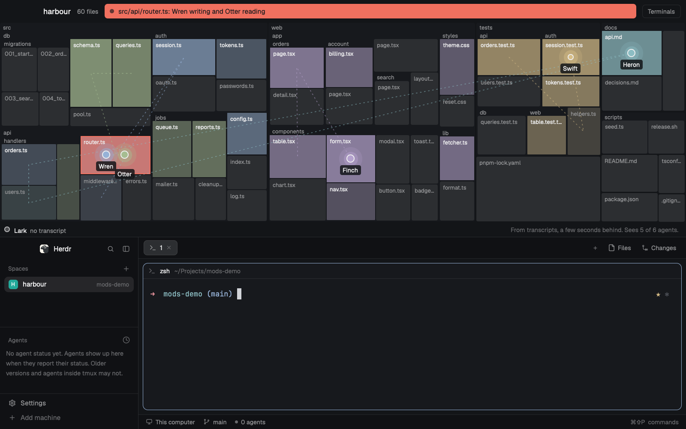

# Territory

A live map of your repo across the top of the window. Folders are blocks, files are blocks inside them, and each coding agent is a glowing dot that glides to the file it last read or changed. Files an agent writes light up in that agent's colour and fade over five minutes, so you can see who has been working where. When two agents have the same file in hand and one of them is writing, that block flashes in the theme's `blocked` colour and a line names the file and both agents. Your terminals stay underneath.

## What you see

Top to bottom, filling the window, with no title bar. All colours come from the theme, so the map follows whatever theme the person has picked.

1. **The map block**, 460px high, on `canvas`. Drag its lower edge to resize it, from 44px to 900px.
   - **Header**, 44px. Left inset 16px, or 84px on macOS outside full screen, for the window buttons.
     - The repo's name at 15px semibold.
     - From 640px wide, the file count at 12px in `muted`: `318 files`, or `48,211 files, 47,980 in groups`.
     - **The collision line** in the middle, filling the space: 28px high, 6px corners, solid `blocked` with `background` text at 13px semibold, and a small dot in front that pulses. It reads `src/api/router.ts: Wren writing and Otter reading`, with `(+1 more)` when there are others.
     - A button on the right, 26px high, 1px `border`, 12px `muted` text. It reads Terminals, or Map when folded.
   - **The map**, the rest of the height less the dock. Shorter than 100px, it isn't drawn and only the header shows.
     - **Folders:** `surface` blocks with their name at 11px `muted` along the top, in a 16px strip. A chain of single folders reads as one, like `src/main/java/acme`.
     - **Files:** `raised` blocks, 3px corners, 2px apart, with the file's name at 11px in `muted` when the block is at least 44px wide and 18px high. A block's area follows the cube root of the file's bytes, with a floor of 256 bytes, so a lockfile can't take half the map.
     - **Groups:** whatever would come out smaller than the smallest block in its folder becomes one block reading `43 small files`. A folder too small to open up is one block reading `parsers/`.
     - **Heat:** a block an agent wrote is filled with that agent's colour at 22% to 90%.
     - **A read:** the block takes a 14% tint of the agent's colour, and a 1.5px dashed line at 50% runs through the places the agent read in the last 2 minutes, up to its dot.
     - **A collision:** the block flashes in `blocked` with a 2px `blocked` border.
     - **Dots:** a core with a 2px `foreground` ring, sized to the block's width over 85, from 11px to 17px, and three quarters of that for a subagent. A working agent has a ring at 1.7 times its size and a halo at 2.8 times. The agent's name sits under it at 12px medium on a dark chip, or above it near the foot of the map. The name is the one Herdr's Agents list shows: the terminal's, a named tab's, or its space's. Only with none of those does the Claude Code session's own name stand in, since an unnamed session's is the folder and a few random letters. A dot keeps 12px from the map's sides, so one on an edge block stays whole. Agents on one block fan out side by side, with their names stacked.
   - **The dock**, 28px along the foot. Agents with no place on the map wait on the left, each with a small dot, its name and, in `muted`, why: `no transcript`, `no file yet` or `outside the repo`. A `+3` counts any that don't fit. On the right, at 12px in `dim`: `From transcripts, a few seconds behind. Sees 3 of 4 agents.` Below 760px wide it shortens to `Seconds behind. Sees 3 of 4.` A read that failed shows here instead, in `blocked`.
   - **The card**, 280px wide on `popover` with a 1px `input` border and 8px corners, beside a pressed block, or on its other side if there's no room. A 58px head has the path in the terminal font at 12px and the size under it. Below are 28px rows, up to 6: a 10px dot, the agent's name, and `wrote 2 min ago`, `read just now`. With nobody to list it says `No agent here in the last 15 minutes`.
2. **The window underneath**, the rest of the height: Herdr's main layout, unchanged. Spaces and agents sidebar, tab bar, terminals in cards, the Files and Changes panel, the status bar.

Agents take colours in this order: `ansi4`, `ansi2`, `ansi5`, `ansi6`, `ansi3`, `ansi12`, `ansi10`, `ansi13`, `ansi14`, `ansi11`. Any that equal `blocked` are left out, and the reds are never used. An agent keeps its colour.

## How it behaves

| Status | Dot |
| --- | --- |
| working | full colour, with a halo that breathes between 14% and 40% every 2.2s |
| blocked | `blocked` ring and halo, beating between 20% and 75% every 0.8s, name in `blocked` |
| done | `done` ring, no halo, 65% |
| idle | no halo, 65% |

- **Which repo:** the focused space's. Its folder is the focused pane's, else its first terminal's, else the folder it was made in, else home. The map is of the whole repo around that folder, from `git ls-files`, tracked files and new ones git doesn't ignore. It looks for a change of folder once a second.
- **Who's on it:** every agent in the focused space, every agent in another space whose folder is in the repo, whatever those started with `hc run`, and their subagents. Up to 12 dots show.
- **Moving:** a dot springs to the file of the agent's latest `Read`, `NotebookRead`, `Write`, `Edit`, `MultiEdit`, `NotebookEdit`, or `Grep`, `Glob` or `LS` with a path. A call that came back as an error doesn't count. A call outside the repo sends the dot to the dock. So does 10 minutes with no call.
- **Heat:** one write starts at 70%, and each more within 5 minutes adds 15%, up to 100%. It then runs down to nothing over 5 minutes from the last write, in 10 steps, on a 15 second beat, with a 1.2s fade between steps. The block takes the colour of whoever wrote last.
- **Collision:** a file is in collision while two agents have read or written it within the last 2 minutes and at least one of those was a write. It clears by itself when the write leaves that window. `Grep`, `Glob` and `LS` don't count as holding a file. A session and its own subagent don't collide, but two subagents do.
- **How honest it is:** it reads tool calls from transcripts every 3 seconds, so it lags by seconds. It only sees agents whose transcripts it can read. It doesn't see a file changed by a shell command, or by anything that isn't one of the tools above. Other programs' agents sit in the dock reading `no transcript`.
- **Press a block:** the card shows who has been there in the last 15 minutes. Press a row to go to that agent. Press the block again to close it. Press the collision line to open the card for its file.
- **Press a dot:** `pane.focus` on that agent's pane. An agent with no pane opens with `terminal.peek`. A subagent has no terminal, so it goes to the session that started it.
- **Terminals**, or `ctrl-shift-m`: folds the block to its 44px header, so the terminals take the room. The collision line stays in view and reads carry on. Map, or the key again, brings it back to the height it had.
- **Dragging** the header moves the window.
- **Empty:** the map's middle says `No git repo here` with the folder, `Nothing in this repo yet`, `This folder has gone`, `git isn't installed`, `Couldn't read the repo` with why, `No space in focus`, or `This space is on vps`. Agents wait in the dock.
- **Huge repo:** at most 140 blocks. The header says how many files are in groups.
- **Demo mode:** with `"props": { "demo": true }` on the `territory` block, a made-up 60 file repo called `harbour` runs a 24 step story, a step every 1.5 seconds, on a clock where a step is 15 seconds, so heat fades while you watch. Six made-up agents: Wren, Otter, Finch, Heron, Swift (Wren's subagent) and Lark, who has no transcript. Wren and Otter collide on `src/api/router.ts` from step 7 to step 15, and Heron is blocked from step 19 to step 22. The loop has no seam. It needs no repo or agents and reads nothing. Blocks open their card, and a dot does nothing when pressed.

## Built from

- **The layout** (`layouts/territory.json`): Herdr's main layout, keeping `cloned_from`, with no `theme` or `colors` of its own. Its root becomes a `column` with `titlebar: "none"`, `traffic_lights: [12, 16]` and `preview: "mods/territory/preview.svg"`.
  - `territory`: a `block`, `size: { px: 460 }`, `min: 44`, `max: 900`, `window_drag: true`, content `{ mod: "territory" }`.
  - `body`: a `row` holding main's `sidebar` and `work` nodes as they are.
- **Why the map sits above the terminals:** a `stack` would give it the whole window, but then the tab block isn't shown. The tab pills, the agents list and toasts all go to terminals that block has to show, and none of them can switch a stack, so they'd seem to do nothing, and keys could go to a terminal nobody can see. It would also hide the warning while you work. Side by side, the map can't fold to anything useful, because a line of text needs width. On top, every shipped control keeps working, a treemap stretches to any shape, and `layout.resize` folds the block to a strip that still carries the warning, one press from terminals with almost all the room.
- **One mod** (`mods/territory/`), `mod.json` `{ "place": "none", "title": "Territory" }`:
  - `treemap.js`: the blocks. `calls.js`: tool calls to places. `activity.js`: heat, trails, the collision window. `crew.js`: which folder and which agents. `frame.js`: one picture, with a signature. `poll.js`: time limits and whether the block can be seen. These import nothing from Herdr.
  - `demo.js`: the story, as fake calls that go through the same rules.
  - `view.js`: the drawing. `main.js`: the state and the timer. `territory.py`: the reading.
  - `props`: only `demo`.
- **Shipped mods it uses** through main's nodes: `workspace-chrome`, `spaces`, `agents`, `tabs`, `pane`, `files`, `changes`, `workspace-status`.
- **Herdr functions:** `agents`, `appHome`, `exec`, `focused`, `hc`, `home`, `layout`, `nextCommand`, `panes`, `props`, `run`, `settings`, `spaces`, `theme`, `window`. The runtime's own `window.paint_path` draws the trails.
- **Commands:** `pane.focus`, `terminal.peek`, `layout.resize`.
- **Motion:** `.spring("left")` and `.spring("top")` on dots, `{ response: 520, damping: 0.86 }`. `.transition("opacity")` on heat, 1200ms ease-out. `.loop("opacity")` on halos, the flash and the line's dot.
- **Timer:** one `cx.timer.every` at 1,000ms, or 1,500ms in demo mode. No other timer. Reads go through `cx.spawn`, with `cx.sleep` for time limits: 8s for `hc`, 20s for transcripts, 25s for the file list.
- **Programs:**
  - `hc ls --all --json` every 3 seconds, and `hc get <terminal> --json` at most every 20 seconds per terminal, for its process ids.
  - `python3 -I -S territory.py calls --since MS --session '{"key":"t4","pids":[123]}'` every 3 seconds. The first read reaches back 15 minutes and each later one 10 seconds behind the last, with repeats dropped.
  - `python3 -I -S territory.py files --dir FOLDER --stamp STAMP` every 30 seconds, which answers `same` while git's index hasn't changed, and at once on a change of folder. A write to a file the map doesn't have asks again within 10 seconds, once per file.
  - `git rev-parse` and `git ls-files`, from the helper, with `GIT_OPTIONAL_LOCKS=0`.
- **Transcripts:** `sessions/<pid>.json` in `$CLAUDE_CONFIG_DIR` and any `~/.claude*` folder that has a `sessions` folder gives the session, then `projects/<folder>/<session>.jsonl` and `<session>/subagents/agent-<id>.jsonl`. The helper keeps a call's tool and path, and nothing else from it.
- **Key:** `keys.json` binds `ctrl-shift-m` to `territory.fold` in the `layout:territory` section. Merge it into the person's own.
- **Art:** `preview.svg`, for the settings screen.

## Watch out

- **What it runs and reads:** it runs `git`, `python3` and `hc`. It reads Claude Code transcripts, session files and subagent files outside its own folder, in `$CLAUDE_CONFIG_DIR` and `~/.claude*`, and it reads file names and sizes in the repo, not their contents. It makes no network calls and writes nothing but the block's open height, in this mod's `localStorage`. Transcripts hold everything an agent saw. The helper prints only tool names, paths, session names and subagent descriptions, and everything it reads is treated as data.
- **Built for macOS, tested this far:** `node --test` and `herdr-app check` pass on macOS and Windows. On macOS it ran in a real Herdr 0.1.13 window at the default zoom of 1.2, with real Claude Code agents on a made-up repo: the empty notes, a repo of 3,676 files drawn as 133 blocks with each render under 6 ms of script, a dot moving to each file read, heat in the writer's colour gone after 5 minutes, a collision between two real agents that cleared after 2 minutes, presses on blocks, dots, the line and the button, `ctrl-shift-m`, one redraw in 40 quiet seconds, and no reads while the block was hidden. Not seen in a real window: a real agent blocked, subagent dots, a space on another machine, Windows and Linux.
- **On Windows,** `python3` can be a store shortcut that only prints a message, which shows as a failed read in the dock.
- **Timers:** a mod has no `setTimeout`, `setInterval` or `clearTimeout`. Calling one breaks the mod. Use `cx.timer` and `cx.sleep`.
- **Never keep a `cx`.** Presses get their own from `on_click`.
- **Redraws:** every redraw redraws the whole window. So `update` builds a frame each tick and only notifies when its signature changes, and fades run on a 15 second beat. Don't put a clock in the collision line, and keep card ages rough, or a redraw comes every second. The signature must also cover the map's shape and what the header and dock say: leave those out and a new file list doesn't draw.
- **Native loops cost frames too.** They run at about 30 fps while drawn, so only working or blocked agents and a live collision have one. A long `.transition` would be the same, which is why a fade is a short step on each beat and not one five minute transition.
- **`.transition` and `.spring` animate later changes.** A dot appears where it is first drawn, and keeps its `id` so it can move.
- **Blocks:** 140 is what a render can afford. Each is one element, plus one or two when lit. Build the layout once per repo and size, not per render.
- **Sizes:** `on_size_change` reports window pixels, while `.w()` and `.left()` are scaled by the zoom. Divide by `settings().zoom`. Path numbers are the app's own pixels and aren't scaled here.
- **`window`:** `view.js` must not import `window` from `herdr`, or `window.paint_path` is gone. `main.js` does import it, for the platform.
- **Presses:** the block has `window_drag`, so the map wrapper, the dots, the line and the button stop the press with `.on_mouse_down("left", ...)`. Stopping it once on the wrapper for all the blocks works in a real window: a press on a block opens its card and doesn't move the window.
- **Names that must match:** the node id `territory`, its 460px and `min` 44 with `BLOCK`, `OPEN_PX` and `FOLD_PX` in `main.js`, and the tool names in `calls.js` and `territory.py`. A block under another id counts as hidden, and reads nothing.
- **Hidden** means the node or anything above it is hidden, or it isn't the active child of a stack. Folded isn't hidden.
- **Limits:** a repo over 30,000 files, or one that takes more than 5 seconds to size, has its other files counted at the mean size. The helper sends the 1,500 biggest files by name and the rest as counts for up to 400 folders. New files are skipped if listing them takes more than 4 seconds. It reads the last 1 MiB of a transcript and 256 KiB of a subagent's, keeps 200 calls from each and 8 subagents a session, and opens nothing unchanged since the last read. A burst bigger than that between two reads loses calls.
- **Paths:** a path reached through a symlink doesn't match the repo's top, so that agent reads `outside the repo`. A git worktree is its own repo, and two agents in two worktrees don't collide.
- **Other machines:** a space on another machine shows a note, because the helper and the transcripts are here.
- **A new file** with no block lands on its folder until the next list. If its folder has a group block, it stays in the group.
- **The map rearranges** when the file list changes, and dots spring to the new places.
- **The window buttons** on Windows and Linux stay with the tab bar, under the map.
- **Keys:** `ctrl-shift-m` is new here and may clash with a person's own binding.
- If `territory` is taken, rename the layout file, the `mod` name, the node id, the `layout:territory` key section, `BLOCK` and the `mods/territory/` paths in `main.js` and the layout.

## Done when

- `node --test` passes from the repo's top folder.
- `herdr-app check mods/territory` passes.
- `mods/territory/` has no `setTimeout`, `clearTimeout` or `setInterval`.
- With no repo the map says `No git repo here`, and an empty repo says `Nothing in this repo yet`.
- A repo with thousands of files draws at most 140 blocks and says how many are in groups.
- An agent's dot moves to the file it reads, with its name beside it.
- A file an agent writes lights up in its colour and is dark again 5 minutes later.
- With one agent writing a file and another reading it within 2 minutes, the block flashes, the line names the file and both agents, and both clear 2 minutes after the last touch.
- Pressing a block lists its recent agents, and pressing a dot focuses that agent.
- Terminals folds the block to 44px with the collision line still showing, and Map brings it back.
- A map with nothing changing doesn't redraw between fade beats.
- A hidden block reads nothing and draws nothing.
- With `"props": { "demo": true }`, the map runs with no repo and no agents, and shows the collision.
